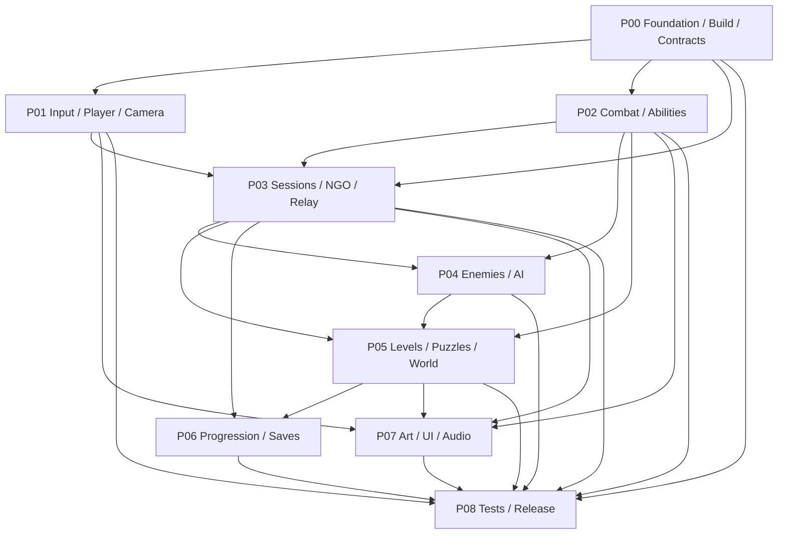

# AVATAR5 — Gesamtarchitektur und Modulgrenzen

**Version:** 1.0 · **Status:** Design-Baseline · **Gültigkeit:** alle Arbeitspakete P00–P08

## 1. Systemziel

Windows-Spiel, 1–4 Spieler online, gemeinsame 3D-Welt mit isometrischer Kamera, 4 Elementklassen, 24 möglichen Fähigkeiten und 3–5 h linearer Kampagne. Ziel ist ein einzeln testbarer, datengesteuerter **Gameplay Core**, eingebettet in eine Unity-Anwendung mit modular getrenntem Networking, Welt-, KI-, Persistenz- und Darstellungssystem.

## 2. Technisches Leitbild

**Hinweis:** Das Diagramm zeigt Abhängigkeiten, keine strikt lineare Entwicklungsabfolge. P03 startet vor der vollständigen Umsetzung von P02; P07 beginnt als Visual-Style-Spike bereits unmittelbar nach P00. P08 begleitet alle Pakete ab Projektbeginn.

## 3. Modulverantwortung und Schnittstellen

| Paket | Besitzt / ändert | Konsumiert | Veröffentlicht an |
|---|---|---|---|
| P00 Foundation | Build, Konfiguration, Dependency-Richtlinien, Contracts | Anforderungen | alle Pakete |
| P01 Input/Camera | Action Maps, lokale Controls, Kamera | World-Collision, Session-Identität | P02, P03, P07 |
| P02 Combat | Ability-Definitionen, Damage/Status-Regeln, Combat-Events | PlayerIntent, Hostkontext, WorldQuery | P03, P04, P05, P06, P07 |
| P03 Multiplayer | Session-/Transport-Lebenszyklus, Authorität, Replikation | Commands & deterministische Regeln | P01, P02, P04–P07 |
| P04 AI | Gegnerzustände, Brain, Encounter/Bossphasen | Combat-Service, Navigationswelt | P05, P06, P07 |
| P05 World | Level-Ids, Interaktionsobjekte, Rätsel/Mission | Combat, AI, Session | P06, P07 |
| P06 Progression | Ausrüstung/XP/Talente, Save-Schemas, Checkpoints | Combat- und World-Events | P01, P02, P05, P07 |
| P07 Presentation | Toon-Shader, Outlines, UI, Audio, Asset-Register | alle relevanten Ereignisse | Spieler, QA |
| P08 Quality | Tests, Telemetrie, Packaging, Releasekriterien | alle Module | Freigaben |

## 4. Harte Invarianten

1. **Host Authority:** Ein Client meldet Absichten; der Host prüft die Aktion und bestimmt den endgültigen Weltzustand. Niemals clientseitig HP, Loot, XP, Rätsel-/Questabschluss bestätigen.
2. **Core vs. Integration:** `Avatar5.Gameplay` kennt weder Unity UI noch Sessions-/Relay-Services. Unity-spezifische Adapter bleiben außerhalb der reinen Domänenlogik; wo `UnityEngine` für Vektoren nötig ist, kapseln oder ersetzen.
3. **IDs statt Scene-Referenzen:** Persistente Fähigkeiten, Gegnerarchetypen, Quests, Level, Interactables haben unveränderliche IDs. Reine Runtime-NetworkIds niemals speichern.
4. **Datengesteuert:** Definitionswerte in ScriptableObjects (Unity-Seite) → validierte, serialisierbare Runtime-Definitionen; kein Gameplay-Balancing in Codekonstanten.
5. **Nur eine Quelle pro Zustand:** `Health` wird in Combat autoritativ geschrieben; `MissionState` in World; `SaveData` in Persistence; `SessionState` in Networking.
6. **Keine doppelten Events:** Damage/Reward/Checkpoint besitzen EventId + ServerTick; mehrfach empfangene Events dürfen nicht doppelt angewendet werden.
7. **Solo = Host mit einer Person:** kein separates Singleplayer-Kampfsystem.
8. **Netzwerkdaten minimal:** Nur Zustandsänderungen und erforderliche Bewegungs-/Actiondaten synchronisieren; Partikelemission, Kamera-Shake, Bildschirmkontur bleiben lokal.
9. **Lizenzhygiene:** keine geschützten Avatar-/Borderlands-Assets, Figuren, Stories, Logos, Musik oder 1:1 kopierte Designs.
10. **Reproduzierbare Builds:** Assets und Szenen samt `.meta`-Dateien versionieren; `Library/` nicht committen.

## 5. Baugruppen / Assembly-Konvention

- `Avatar5.Contracts` — flache DTOs, IDs, Event-Definitionen; darf nicht auf Implementierungsassemblies verweisen.
- `Avatar5.Gameplay` — regelseitiges Combat, Progression-Domäne, Mission-State-Maschinen; verweist nur auf Contracts und minimalen Runtime-Abstraktionen.
- `Avatar5.Input` — Eingabe und Camera-Adapter (`PlayerInputAdapter`, `IsometricCameraRig`, `CameraProfile`).
- `Avatar5.Player` — Unity-Adapter des Charakter-Motors (`CharacterMotor` um den engine-freien `PlayerMotorCore` aus `Avatar5.Gameplay`), kennt weder Geräte noch HUD noch Sessions.
- `Avatar5.Networking` — Unity NGO, MPS-Sessions, Relay, Host-Adapters.
- `Avatar5.AI` — Entscheidungen, Gegner, NavMesh-Integration.
- `Avatar5.World` — Level-Flow, Interactables, Quests.
- `Avatar5.Persistence` — Save-Schema und I/O.
- `Avatar5.Presentation` — Art, Renderer Features, UI, VFX und Audio.
- `Avatar5.Tests` — EditMode-/PlayMode-/Netzwerkintegrationstests.

Dependency-Regel: Contracts ist der einzige allgemeine gemeinsame Kern. Querverbindungen laufen über definierte Ports/Events (siehe `10_SCHNITTSTELLENVERTRAEGE.md`). `Presentation` liest Zustände und Events, schreibt keine Domänenzustände.

## 6. Verteilte Spielausführung

**Client:** erfasst `PlayerCommand`, lokale Animations-/Eingabevorbereitung, Kamera, UI, Effekte, Audio. **Host:** validiert Actor/Ownership, Cooldown/Ressourcen, Reichweite/Sichtlinie, Kollisions-/Hit-Resultat, HP, AI, Questfortschritt und Rewards. **Transport:** NGO + MPS Sessions/Relay. Unterschiedliche Nachrichtenklassen: `PlayerCommand` (Client→Host), `EntitySnapshot/StateChange` (Host→Clients), `PresentationCue` (Host→Clients, dedupliziert).

Initiale Tickrate: **20 Netzwerk-/Simulations-Ticks/s als messbarer Startwert**, Darstellung 60 FPS Ziel; keine Garantie, keine Replikation pro gerendertem Frame. Client Prediction/Reconcilation wird nach M2 anhand gemessener Latenz entschieden. Verbindungsabbruch des Hosts beendet in v1 die Session; gesicherte Checkpoints bleiben verfügbar. Keine implizite Host-Migration versprechen.

## 7. Szenenstrategie

`Bootstrap` (Services/DI/Version) → `MainMenu` → `Lobby` → `Hub` → `Level_01` … `Level_05` → `Results`. Jede Spielszene besitzt einen SceneContext und referenziert LevelDefinition, EncounterRegistry und SaveCheckpointIds. Autorisierte Netzwerk-Szenenwechsel werden zentral durch den Host gesteuert; late join nur in freigegebenen Zuständen (Lobby/Hub/Checkpoint) und mit initialem vollständigem Snapshot.

## 8. Entscheidungslog

| ID | Entscheidung | Begründung |
|---|---|---|
| ADR-001 | Unity 6.3 LTS / URP | Windows, C#, stylisierte Renderpipeline, vorhandene Tools |
| ADR-002 | NGO + MPS Sessions/Relay | Schlankes 1–4-Spieler-Hosting ohne eigenen Server |
| ADR-003 | Host-authoritative | konsistente kooperative Welt und Combat-Regeln |
| ADR-004 | Modularer Monolith | weniger Infrastruktur- und Integrationskosten |
| ADR-005 | Toon + schwarze Silhouette und Kanten | gewollter comicartiger Look, gut lesbar in Iso-Kamera |
| ADR-006 | Rechtefreie/eindeutig lizenzierte Assets | finanzierbarer, unabhängig veröffentlichbarer Erst-Release |
| ADR-007 | Versioniertes lokales Speichern | keine fremde Accounts-/DB-Abhängigkeit in v1 |

## 9. Fertigstellungskriterien Gesamtprodukt

Eine Story ist nur fertig mit implementiertem Verhalten, passenden Tests, Editor-kompatiblen Assets, Dokumentation der Verträge und belegtem Build. Jeder Meilenstein fordert reale Spieltests; ein kompiliertes Projekt allein ist kein abgenommenes Action-RPG.

## 10. Reihenfolge für Codex

Baseline: P00 → P01 (lokales Greybox) → P03 (2–4 Spieler) → P02 (Combat) → P04 → P05 → P06; P07 Art-Spike direkt nach P00 und laufende Asset-Integration; P08 kontinuierlich. Vertikal integrieren, nicht neun isolierte Vollimplementierungen erstellen und am Ende zusammenfügen.
