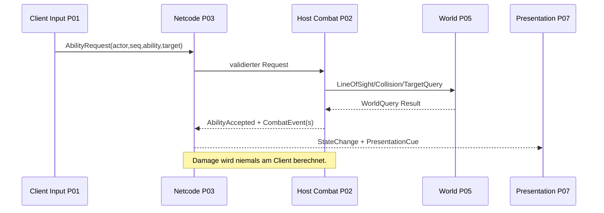

# AVATAR5 — Verbindliche Schnittstellenverträge v1.0

**Status:** Architekturspezifikation (C#-Pseudoverträge, noch kein lauffähiges SDK-Modul). **Regel:** Diese Datei ist die gemeinsame Quelle. Paketdokumente referenzieren sie statt eigene inkompatible DTOs einzuführen.

## 1. Einheitliche Begriffe / Eigentümer

| Vertrag / Datenobjekt | Eigentümer | Schreibt | Liest |
|---|---|---|---|
| `PlayerCommand`, `PlayerPose` | P01/P03 (Command vs. autoritative Pose) | P01/Host | P02, P03, P07 |
| `SessionState` | P03 | P03 | P01, P05, P07 |
| `AbilityDefinition`, `AbilityRequest` | P02/P00 Contracts | Asset-Autoren / P01/P04 | P02/P03 |
| `ActorCombatState`, `CombatEvent` | P02 | Host-P02 | P03–P07 |
| `EnemyBrainState`, `EncounterEvent` | P04 | Host-P04 | P03, P05–P07 |
| `WorldState`, `WorldEvent` | P05 | Host-P05 | P03, P06, P07 |
| `ProgressionState`, `SaveGame` | P06 | Host-P06 | P02, P03, P07 |
| `PresentationCue` | Contracts aus P02/P04/P05 | Host-Ereignis | P03 transportiert, P07 zeigt |

## 2. Identitäten und Versionen

- `EntityId`: stabile Laufzeit-ID pro Actor/Objekt innerhalb einer Session; nicht automatisch dasselbe wie eine NGO `NetworkObjectId`.
- `ContentId`: unveränderlicher String oder feste numerische Katalog-ID für Ability, Level, Puzzle, EnemyType, Talent; eindeutige registrierte Zuordnung und Content-Hash.
- `PlayerId`: Session-Zuordnung, *nicht* automatisch dauerhaft für die Account-/Save-Identität.
- `EventId`: global innerhalb eines Spielstandes oder Sessions eindeutig, deduplizierbar.
- `SequenceId`: monoton pro Client/Actor für Command-Reihenfolge.
- `ServerTick`: authoritative Zeiteinheit; Clients verwenden Timestamps nur zu Diagnose/Prediction.
- `SchemaVersion`, `ProtocolVersion`, `ContentVersion`: vor Save-Load bzw. Join prüfen. Für Release ungeklärte Versionsmismatchs ablehnen.

## 3. Logische Kernverträge (Illustration)

```csharp
// Architekturskizze, NICHT als fertiger NGO-Serialisierungscode verstehen.
namespace Avatar5.Contracts;

public enum ElementKind : byte { Fire, Water, Earth, Air }
public enum PlayerActionKind : byte { None, Cast, Interact, Dodge }

public readonly record struct PlayerCommand(
    ulong ActorId, uint SequenceId, uint ClientTick,
    Float2 Move, Float2 Aim, PlayerActionKind Action,
    int ActionRefId);

public readonly record struct AbilityRequest(
    ulong ActorId, uint SequenceId, int AbilityId,
    Float2 TargetOnGround, uint ClientTick);

public readonly record struct CombatEvent(
    ulong EventId, uint ServerTick, ulong SourceActorId,
    ulong TargetActorId, int AbilityId, int EffectId,
    float Amount, int ResultKind);

public readonly record struct WorldEvent(
    ulong EventId, uint ServerTick, int LevelId,
    int WorldObjectId, int StateCode);

public readonly record struct PresentationCue(
    ulong EventId, uint ServerTick, int CueId,
    Float3 Position, Float3 Direction, uint VisualSeed);

// Float2/Float3 = vom Core definiertes serialisierbares POD,
// in Unity-Adapter zu Vector2/Vector3 und NGO-INetworkSerializable gemappt.
```

**Wichtig:** Beispiel-Records definieren Semantik, nicht die fertige Netzwerkserialisierung. In der echten Unity-Implementierung je nach NGO-Version `INetworkSerializable`/unterstützte Serializer und kompatible RPC-APIs verwenden, byte-/bandbreitensparend quantisieren, Endianness und Versionierung testen.

## 3a. Umgesetzte P01-Verträge (`Avatar5.Contracts/PlayerContracts.cs`)

```csharp
public struct PlayerPose {            // lesbarer Bewegungs-/Ziel-Snapshot eines Actors
    ulong ActorId; uint LastProcessedSequenceId;
    Float3 Position; Float3 Velocity;   // Welt, Meter bzw. m/s
    float FacingYawDegrees;             // Grad, im Uhrzeigersinn ab Welt +Z
    Float2 AimDirection; }              // Einheitsvektor Welt-XZ oder (0,0)
public interface IPlayerCommandSink { RequestStatus Submit(in PlayerCommand command); }
public interface IPlayerPoseSource  { PlayerPose CurrentPose { get; } }
```

Semantik von `PlayerCommand` ab P01:
- `Move`: **kamerarelativ bereits in Welt-XZ umgerechnete** Bewegungsabsicht (`X` → Welt x, `Y` → Welt z), Länge ≤ 1 (Analogwert erlaubt, Diagonale nie schneller). Die Kamera ist rein lokal, deshalb rechnet der Client um; der Host erhält nur die Welt-Absicht und clampt erneut.
- `Aim`: Einheitsrichtung Welt-XZ vom Actor zum Ziel oder `(0,0)` = kein Ziel (Actor blickt in Laufrichtung). Keine absolute Zielkoordinate; P02 kann im `AbilityRequest` einen Ground-Target-Punkt ergänzen.
- `Action`/`ActionRefId`: Flanke `Cast`/`Interact`/`Dodge` im Frame des Drückens; `ActionRefId` = Fähigkeiten-Slot (bis P02 immer 0).
- `SequenceId` strikt steigend pro Actor; `ClientTick` aus 20-Hz-Clienttakt (Diagnose/Ordnung, keine Autorität).
- `IPlayerCommandSink.Submit` liefert `Accepted`, `RejectedNoAuthority` (fremde ActorId) oder `Duplicate` (gleiche/ältere SequenceId). In P01 ist der lokale `CharacterMotor` die Senke; P03 schaltet eine Netzwerk-Senke davor und prüft zusätzlich die Connection-Ownership.
- Für `IPlayerCommandSink` ersetzt `RequestStatus` die `CommandResult`-Skizze aus §4.

## 3b. Umgesetzte P03-Session-Verträge (`Avatar5.Contracts/SessionContracts.cs`)

```csharp
enum SessionPhase { Offline, Creating, Joining, Connected, Leaving, Failed }
enum SessionRole  { None, Host, Client }
enum SessionError { None, InvalidCode, SessionNotFound, SessionFull, VersionMismatch, TimedOut, Cancelled,
                    AlreadyInSession, ServicesUnavailable, TransportFailed, ConnectionLost, HostEnded, Kicked, Unknown }
struct SessionConfig { int MaxPlayers; int ProtocolVersion; int ContentVersion; }   // Default: 4 / VersionContracts
struct SessionState  { SessionPhase Phase; SessionRole Role; string JoinCode; int PlayerCount; int MaxPlayers;
                       ulong LocalPlayerId; SessionError LastError; bool IsActive; }
struct SessionJoinResult { bool Success; SessionError Error; string Detail; SessionState State; }
interface ISessionService {
    SessionState State { get; }  event Action<SessionState> StateChanged;
    Task<SessionJoinResult> CreatePrivateAsync(SessionConfig config, CancellationToken token);
    Task<SessionJoinResult> JoinAsync(string joinCode, SessionConfig config, CancellationToken token);
    Task LeaveAsync(CancellationToken token); }
```

- Abweichung zur Skizze in §4: `JoinAsync` erhält zusätzlich die `SessionConfig`, weil der Client seine eigene Protokoll-/Content-Version im Handshake mitschickt. `JoinResult` heißt `SessionJoinResult`.
- `SessionState` wird nur vom Session-Service geschrieben. `LocalPlayerId` ist die Transport-Client-Id **dieser** Session, keine dauerhafte Identität (§2 `PlayerId`).
- `Detail` ist nur für Logs (ohne Tokens/persönliche Ids); die UI zeigt einen Text pro `SessionError`.
- **Versions-Handshake:** Der Client sendet mit der Verbindungsanfrage 12 Byte (`"AVA5"`, ProtocolVersion, ContentVersion, little-endian, `Avatar5.Gameplay.Session.ConnectionPayload`). Der Host prüft vor jedem Spawn (`SessionAdmission`): fehlende/fremde Daten oder andere Version → `VersionMismatch`, belegte Plätze ≥ `MaxPlayers` (max. 4, Host zählt mit) → `SessionFull`, Host fährt herunter → `HostEnded`. Der Ablehnungsgrund geht als `"A5:<SessionError>"` an den Client zurück.
- **Join-Codes:** Relay-Codes werden getrimmt, ohne Leer-/Bindestriche, großgeschrieben, 4–16 ASCII-Buchstaben/Ziffern. Direktverbindung (LAN/Test): `IPv4[:Port]` oder `localhost[:Port]`, Standardport 7777.

## 4. Ports der Domain (Implementierung über Interface)

```csharp
public interface IPlayerCommandSink { CommandResult Submit(in PlayerCommand command); }
public interface IAbilityCatalog { AbilityData Get(int abilityId); }
public interface ICombatService { CombatResult TryResolve(in AbilityRequest request, in CombatContext context); }
public interface ICombatEventStream { IDisposable Subscribe(Action<CombatEvent> consumer); }
public interface IWorldQuery { bool HasLineOfSight(Float3 from, Float3 to); bool IsPositionWalkable(Float3 at); }
public interface IEncounterService { void Start(int encounterId); EncounterState GetState(int encounterId); }
public interface IWorldStateService { WorldState GetCurrent(); InteractResult TryInteract(ulong actorId, int objectId); }
public interface IStatProvider { ActorStats GetStats(ulong actorId); }
public interface IProgressionService { RewardResult Apply(RewardEvent reward); TalentResult Choose(TalentChoice choice); }
public interface ISaveService { SaveResult Save(CheckpointSnapshot snapshot); LoadResult Load(string saveId); }
public interface ISessionService { /* umgesetzt, siehe §3b */ }
public interface IPresentationEventSink { void Present(in PresentationCue cue); }
```

`AbilityData`, `CombatContext`, `ActorStats` etc. sind bewusst noch nicht vollständig ausmodellierte **kanonische Erweiterungspunkte**. P00 muss vor Implementierung konkrete Typdefinitionen im Contracts-Modul erstellen und mit P02/P03 gegenkompilieren. Es darf keine widersprüchlichen ad-hoc-Versionen in anderen Assemblies geben.

## 5. Nachrichtenflüsse

### A. Spieler wirkt Fähigkeit



### B. Boss besiegt, Mission voranschreiben
`P02.ActorDefeated(eventId)` → `P04.EncounterCompleted(encounterId,eventId)` → `P05.LevelCompleted(levelId,eventId)` → `P06.RewardEvent/CheckpointSaved` → `P03.ReplicateState` → `P07.ResultScreen`.

### C. Weltzustand speichern und laden
`P05.CheckpointReached` → `P06.CreateSnapshot` → `P06.AtomicSave`; beim Wiederaufnehmen: `P06.Load` → `P05.Restore` und `P02.Restore` → `P03.NetworkSpawn&Snapshot` → `P07.UpdatedHUD`.

## 6. Fehlercodes, Ablehnungen und Idempotenz

Jeder Request hat `requestId/sequenceId` und strukturierten Status: `Accepted`, `RejectedNoAuthority`, `RejectedCooldown`, `RejectedResource`, `RejectedRange`, `RejectedInvalidState`, `RejectedVersion`, `Duplicate`, `TimedOut`. Verarbeitete Combat/Reward/World-Events werden per Id dedupliziert. Wiederholte `Apply`-Anrufe dürfen weder HP nochmals senken noch Loot nochmals erzeugen.

## 7. Versionierung und Schnittstellenänderungen

Schemaänderungen mit Kompatibilität und Migration dokumentieren. Jede Änderung verlangt: Contract-Datei, Producer, Consumers, Serializer, Netzwerk-/Save-Version, Tests und ADR. Für breaking Protocol Changes im Alpha-Stand einfach Join inkompatibler Clients verweigern; keine unsicheren stillen Konvertierungen.

## 8. Testfälle (Pflicht)

1. Actor A sendet `Cast` doppelt mit gleicher SeqId → genau eine Ausführung.
2. Client versucht fremde ActorId → `RejectedNoAuthority`.
3. Host verursacht Damage an Gegner → Client HUD identischer Wert nach Snapshot.
4. CombatEvent bei Paket-Wiederholung → keine doppelten Rewards.
5. Scene-Rejoin nach Checkpoint → identischer WorldObject-/Queststatus.
6. Unterschiedliche ProtocolVersion → vor aktiver Session abgewiesen.
7. PresentationCue fällt aus → kein Gameplay-Zustand ändert sich dadurch.

## 9. Verantwortlichkeit und Schnittstellenfreigabe

Vor Änderungen an Public Contracts: P00/P08 prüfen API, P03 prüft Replikation, betroffene Pakete aktualisieren ihre Testfälle. Gute lokale Interfaces dürfen existieren, aber nicht als zweite öffentliche Wahrheit für die gleichen fachlichen Daten.
