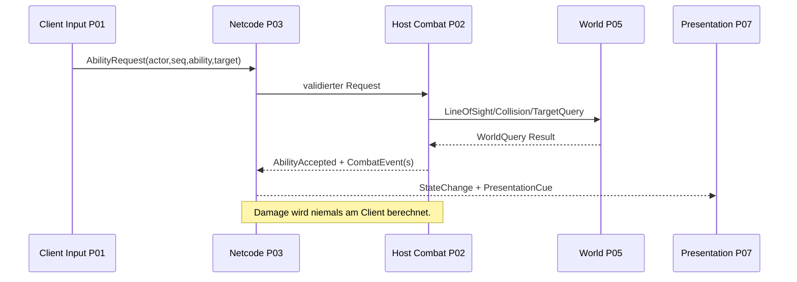

# AVATAR5 — Verbindliche Schnittstellenverträge v1.0

**Status:** Architekturspezifikation (C#-Pseudoverträge, noch kein lauffähiges SDK-Modul). **Regel:** Diese Datei ist die gemeinsame Quelle. Paketdokumente referenzieren sie statt eigene inkompatible DTOs einzuführen.

## 1. Einheitliche Begriffe / Eigentümer

| Vertrag / Datenobjekt | Eigentümer | Schreibt | Liest |
|---|---|---|---|
| `PlayerCommand`, `PlayerPose` | P01/P03 (Command vs. autoritative Pose) | P01/Host | P02, P03, P07 |
| `SessionState` | P03 | P03 | P01, P05, P07 |
| `AbilityDefinition`, `AbilityRequest` | P02/P00 Contracts | Asset-Autoren / P01/P04 | P02/P03 |
| `ActorCombatState`, `CombatEvent` | P02 | Host-P02 | P03–P07 |
| `EnemyBrainState`, `EncounterEvent` | P04 | Host-P04 | P03, P05–P07 |
| `WorldState`, `WorldEvent` | P05 | Host-P05 | P03, P06, P07 |
| `ProgressionState`, `SaveGame` | P06 | Host-P06 | P02, P03, P07 |
| `PresentationCue` | Contracts aus P02/P04/P05 | Host-Ereignis | P03 transportiert, P07 zeigt |

## 2. Identitäten und Versionen

- `EntityId`: stabile Laufzeit-ID pro Actor/Objekt innerhalb einer Session; nicht automatisch dasselbe wie eine NGO `NetworkObjectId`.
- `ContentId`: unveränderlicher String oder feste numerische Katalog-ID für Ability, Level, Puzzle, EnemyType, Talent; eindeutige registrierte Zuordnung und Content-Hash.
- `PlayerId`: Session-Zuordnung, *nicht* automatisch dauerhaft für die Account-/Save-Identität.
- `EventId`: global innerhalb eines Spielstandes oder Sessions eindeutig, deduplizierbar.
- `SequenceId`: monoton pro Client/Actor für Command-Reihenfolge.
- `ServerTick`: authoritative Zeiteinheit; Clients verwenden Timestamps nur zu Diagnose/Prediction.
- `SchemaVersion`, `ProtocolVersion`, `ContentVersion`: vor Save-Load bzw. Join prüfen. Für Release ungeklärte Versionsmismatchs ablehnen.

## 3. Logische Kernverträge (Illustration)

```csharp
// Architekturskizze, NICHT als fertiger NGO-Serialisierungscode verstehen.
namespace Avatar5.Contracts;

public enum ElementKind : byte { Fire, Water, Earth, Air }
public enum PlayerActionKind : byte { None, Cast, Interact, Dodge }

public readonly record struct PlayerCommand(
    ulong ActorId, uint SequenceId, uint ClientTick,
    Float2 Move, Float2 Aim, PlayerActionKind Action,
    int ActionRefId);

public readonly record struct AbilityRequest(
    ulong ActorId, uint SequenceId, int AbilityId,
    Float2 TargetOnGround, uint ClientTick);

public readonly record struct CombatEvent(
    ulong EventId, uint ServerTick, ulong SourceActorId,
    ulong TargetActorId, int AbilityId, int EffectId,
    float Amount, int ResultKind);

public readonly record struct WorldEvent(
    ulong EventId, uint ServerTick, int LevelId,
    int WorldObjectId, int StateCode);

public readonly record struct PresentationCue(
    ulong EventId, uint ServerTick, int CueId,
    Float3 Position, Float3 Direction, uint VisualSeed);

// Float2/Float3 = vom Core definiertes serialisierbares POD,
// in Unity-Adapter zu Vector2/Vector3 und NGO-INetworkSerializable gemappt.
```

**Wichtig:** Beispiel-Records definieren Semantik, nicht die fertige Netzwerkserialisierung. In der echten Unity-Implementierung je nach NGO-Version `INetworkSerializable`/unterstützte Serializer und kompatible RPC-APIs verwenden, byte-/bandbreitensparend quantisieren, Endianness und Versionierung testen.

## 3a. Umgesetzte P01-Verträge (`Avatar5.Contracts/PlayerContracts.cs`)

```csharp
public struct PlayerPose {            // lesbarer Bewegungs-/Ziel-Snapshot eines Actors
    ulong ActorId; uint LastProcessedSequenceId;
    Float3 Position; Float3 Velocity;   // Welt, Meter bzw. m/s
    float FacingYawDegrees;             // Grad, im Uhrzeigersinn ab Welt +Z
    Float2 AimDirection; }              // Einheitsvektor Welt-XZ oder (0,0)
public interface IPlayerCommandSink { RequestStatus Submit(in PlayerCommand command); }
public interface IPlayerPoseSource  { PlayerPose CurrentPose { get; } }
```

Semantik von `PlayerCommand` ab P01:
- `Move`: **kamerarelativ bereits in Welt-XZ umgerechnete** Bewegungsabsicht (`X` → Welt x, `Y` → Welt z), Länge ≤ 1 (Analogwert erlaubt, Diagonale nie schneller). Die Kamera ist rein lokal, deshalb rechnet der Client um; der Host erhält nur die Welt-Absicht und clampt erneut.
- `Aim`: Einheitsrichtung Welt-XZ vom Actor zum Ziel oder `(0,0)` = kein Ziel (Actor blickt in Laufrichtung). Keine absolute Zielkoordinate; P02 kann im `AbilityRequest` einen Ground-Target-Punkt ergänzen.
- `Action`/`ActionRefId`: Flanke `Cast`/`Interact`/`Dodge` im Frame des Drückens; `ActionRefId` = Fähigkeiten-Slot (bis P02 immer 0).
- `SequenceId` strikt steigend pro Actor; `ClientTick` aus 20-Hz-Clienttakt (Diagnose/Ordnung, keine Autorität).
- `IPlayerCommandSink.Submit` liefert `Accepted`, `RejectedNoAuthority` (fremde ActorId) oder `Duplicate` (gleiche/ältere SequenceId). In P01 ist der lokale `CharacterMotor` die Senke; P03 schaltet eine Netzwerk-Senke davor und prüft zusätzlich die Connection-Ownership.
- Für `IPlayerCommandSink` ersetzt `RequestStatus` die `CommandResult`-Skizze aus §4.

## 3b. Umgesetzte P03-Session-Verträge (`Avatar5.Contracts/SessionContracts.cs`)

```csharp
enum SessionPhase { Offline, Creating, Joining, Connected, Leaving, Failed }
enum SessionRole  { None, Host, Client }
enum SessionError { None, InvalidCode, SessionNotFound, SessionFull, VersionMismatch, TimedOut, Cancelled,
                    AlreadyInSession, ServicesUnavailable, TransportFailed, ConnectionLost, HostEnded, Kicked, Unknown }
struct SessionConfig { int MaxPlayers; int ProtocolVersion; int ContentVersion; }   // Default: 4 / VersionContracts
struct SessionState  { SessionPhase Phase; SessionRole Role; string JoinCode; int PlayerCount; int MaxPlayers;
                       ulong LocalPlayerId; SessionError LastError; bool IsActive; }
struct SessionJoinResult { bool Success; SessionError Error; string Detail; SessionState State; }
interface ISessionService {
    SessionState State { get; }  event Action<SessionState> StateChanged;
    Task<SessionJoinResult> CreatePrivateAsync(SessionConfig config, CancellationToken token);
    Task<SessionJoinResult> JoinAsync(string joinCode, SessionConfig config, CancellationToken token);
    Task LeaveAsync(CancellationToken token); }
```

- Abweichung zur Skizze in §4: `JoinAsync` erhält zusätzlich die `SessionConfig`, weil der Client seine eigene Protokoll-/Content-Version im Handshake mitschickt. `JoinResult` heißt `SessionJoinResult`.
- `SessionState` wird nur vom Session-Service geschrieben. `LocalPlayerId` ist die Transport-Client-Id **dieser** Session, keine dauerhafte Identität (§2 `PlayerId`).
- `Detail` ist nur für Logs (ohne Tokens/persönliche Ids); die UI zeigt einen Text pro `SessionError`.
- **Versions-Handshake:** Der Client sendet mit der Verbindungsanfrage 12 Byte (`"AVA5"`, ProtocolVersion, ContentVersion, little-endian, `Avatar5.Gameplay.Session.ConnectionPayload`). Der Host prüft vor jedem Spawn (`SessionAdmission`): fehlende/fremde Daten oder andere Version → `VersionMismatch`, belegte Plätze ≥ `MaxPlayers` (max. 4, Host zählt mit) → `SessionFull`, Host fährt herunter → `HostEnded`. Der Ablehnungsgrund geht als `"A5:<SessionError>"` an den Client zurück.
- **Join-Codes:** Relay-Codes werden getrimmt, ohne Leer-/Bindestriche, großgeschrieben, 4–16 ASCII-Buchstaben/Ziffern. Direktverbindung (LAN/Test): `IPv4[:Port]` oder `localhost[:Port]`, Standardport 7777.

## 3c. P03-Netzwerkspieler (S03-02)

- `RequestStatus` um `RejectedRateLimited` erweitert (am Ende, bestehende Werte unverändert).
- **Actor-Id:** `ActorIds.ForClient(clientId) = clientId + 1` (Host = Actor 1). Gilt nur innerhalb einer Session, wird nie gespeichert.
- **Command-Ingress:** Der Client schickt `PlayerCommand` ohne ActorId (`NetPlayerCommand`, RPC an den Server). Der Host leitet die ActorId aus der sendenden Verbindung ab (`HostCommandIngress`): fremder Sender → `RejectedNoAuthority`, mehr als 60 Befehle/s (Burst 20) → `RejectedRateLimited`, danach prüft das Motor-Gate Duplikate/alte Sequenzen (`Duplicate`).
- **Sende-Drossel Client:** Aktionsflanken sofort, geänderte Absicht höchstens alle 1/30 s, unveränderte Absicht alle 0,2 s (`CommandSendThrottle`).
- **Simulation:** Nur der Host bewegt `CharacterMotor`; Position/Yaw repliziert `NetworkTransform` (Server-Autorität, Interpolation, 20 Ticks/s). `LastProcessedSequenceId` und Zielrichtung kommen als NetworkVariable. Clients lesen `IPlayerPoseSource` von `NetworkPlayerAvatar`; die Geschwindigkeit wird dort aus der Transform-Änderung geschätzt.
- Eine Streckenprüfung entfällt, weil der Client keine Positionen sendet, nur Absichten (Länge wird vom Motor auf ≤ 1 begrenzt).

## 3d. Umgesetzte P02-Kampfverträge (`Avatar5.Contracts/CombatContracts.cs`, S02-01)

```csharp
enum TeamKind { Players, Enemies, Neutral }
enum AbilityTargeting { Projectile, Cone }
[Flags] enum StatusFlags : byte { None = 0, Burning = 1, Wet = 2 }
enum CombatEventKind { AbilityCastAccepted = 1, AbilityRejected, DamageApplied, StatusApplied, StatusRemoved,
                       ReactionTriggered, ActorDefeated, ActorRevived, ProjectileEnded }   // = CombatEvent.ResultKind
enum ReactionKind { None, Steam = 1, Extinguish = 2 }                                       // = CombatEvent.EffectId bei ReactionTriggered
struct ActorCombatState { ulong ActorId; TeamKind Team; float Health, MaxHealth, Energy, MaxEnergy; StatusFlags Status; bool Defeated; }
struct AbilityCastResult { RequestStatus Status; ulong CastId; }
interface IAbilityCatalog { bool Contains(int abilityId); int[] Ids { get; } }
interface ICombatService { AbilityCastResult TryCast(in AbilityRequest request); bool TryGetState(ulong actorId, out ActorCombatState state); }
interface ICombatEventStream { event Action<CombatEvent> EventRaised; }
interface ICombatStateSource { ActorCombatState CombatState { get; } }
```

Belegung der `CombatEvent`-Felder: `EventId` streng steigend pro Session (Cues teilen sich den Zähler); `SourceActorId`/`TargetActorId`; `AbilityId` (0 = Schaden über Zeit); `EffectId` = CastId bei Treffern/Projektilende, `RequestStatus` bei `AbilityRejected`, `StatusFlags` bei Statusereignissen, `ReactionKind` bei Reaktionen; `Amount` = angewandter Schaden, Energiekosten (Cast) oder Statusdauer.

- **Host-only:** `CombatSimulation` (Avatar5.Gameplay, engine-frei) ist die einzige Stelle, die Health schreibt. Prüfreihenfolge eines Casts: Actor existiert/lebt → Sequenz neu (sonst `Duplicate`, ohne Event) → Fähigkeit im Loadout (`RejectedInvalidState`) → Cooldown (`RejectedCooldown`) → Energie (`RejectedResource`) → Richtung vorhanden (`RejectedRange`).
- **Idempotenz:** Jede Kombination (CastId, Ziel) wird höchstens einmal angewendet; Clients verwerfen Events mit bereits gesehener EventId (`CombatEventDeduplicator`).
- **Reaktionen deklarativ** (`CombatRules.Reactions`, erste passende Regel gewinnt): Feuer auf Nass → Dampf (+15 Schaden, Nass weg, kein Brennen); Wasser auf Brennend → Löschen (+5 Schaden, Brennen weg, danach Nass).
- **Transport:** Host bündelt Events und Cues pro Frame als Named Message `A5.Combat` (ReliableFragmentedSequenced) an alle Clients; Lebenspunkte/Energie/Status zusätzlich als NetworkVariable am `NetworkCombatActor`. Präsentation hört lokal auf `Foundation.PresentationBus` und ändert nie Spielzustand.
- **Eingabe:** `PlayerCommand.Action = Cast`, `ActionRefId` = Slot (0 linke Maustaste/rechter Trigger, 1 rechte Maustaste/linker Trigger, neue Action `CastSecondary`). Der Host bildet daraus `AbilityRequest` (Ziel = Position + Zielrichtung × 5 m, ohne Zielrichtung die Blickrichtung).
- **Ids:** Spieler-Actor 1–4 (`ActorIds`), Nicht-Spieler `1000 + NetworkObjectId` (nur Session-gültig, nie speichern).

### 3d-2. Elementklassen (S02-02, Designentscheidung A vom 17.10.2026)

- `StatusFlags.Frozen = 4` (kann weder laufen, zaubern noch eine Ankündigung beenden; friert ein Gegner ein, wird seine laufende Ankündigung abgebrochen). `ReactionKind.Freeze = 3`, `ReactionKind.Flare = 4`.
- `ReactionRule.AbilityId` (0 = jede Fähigkeit des Elements), `AddsDuration`, `RefreshAbilityStatus`. Reihenfolge der Standardregeln: Einfrieren (Eissplitter auf Nass → Gefroren 1,6 s, +6) → Aufflammen (Luft auf Brennend, +12, Brennen läuft weiter) → Dampf → Löschen.
- Klassen = `ElementKind`; `StarterAbilities.LoadoutFor(element)` = { Slot 0 Projektil, Slot 1 Fläche }: Feuer {Feuerball 101, Flammenstoß 102}, Wasser {Eissplitter 202, Wasserwelle 201}, Erde {Steinspieß 301, Beben 302}, Luft {Windklinge 402, Böe 401}.
- Klassenwahl: Lobby oder `-a5-class`; der Owner meldet sie einmal pro Spawn per RPC, der Host setzt Loadout (`CombatSimulation.SetLoadout`) und repliziert das Element (`NetworkCombatActor.Element`).
- **Rätselregel:** Jedes Elementrätsel muss mit jeder Klasse allein lösbar sein. `WorldObjectDefinition.AnyElement` (Elementschrein) nimmt jedes Element an; elementgebundene Ziele sind nur zulässig, wenn es im selben Abschnitt eine Alternative für die anderen Klassen gibt.

## 3e. Umgesetzte P04-Verträge (S04-01, `Avatar5.Gameplay.Enemies`)

```csharp
enum EnemyState : byte { Idle, Approach, Telegraph, Attack, Recover, Return, Dead }   // repliziert am Gegner
sealed class EnemyDefinition { int EnemyTypeId; string Key; float MaxHealth, MoveSpeed, AggroRadius, LeashRadius,
    AttackStartRange, TelegraphDuration (>= 0,3 s), RecoverDuration, RetargetHysteresis; int AttackAbilityId, TelegraphCueId; }
struct EnemyTargetCandidate { ulong ActorId; Float2 Position; bool Alive; int ChasedByOthers; }
sealed class EnemyBrain { EnemyBrainOutput Tick(float dt, Float2 self, IList<EnemyTargetCandidate>); void OnDefeated(); void OnRevived(); }
// CombatSimulation (P02) ergänzt um:
void RaiseTelegraph(ulong actorId, int abilityId, int cueId, Float2 origin, Float2 aimPoint, float seconds); // CombatEventKind.TelegraphStarted = 10
bool IsDefeated(ulong actorId);
```

- Die KI schreibt nie HP: Am Telegraph-Ende wird ein normaler `AbilityRequest` an `CombatSimulation.TryCast` gestellt; dieselben Regeln (Team, Reichweite, einmaliger Treffer) wie für Spieler.
- Zentrum und Richtung des Angriffs werden beim Telegraph-Start eingefroren; wer bis zum Ende aus dem Ring geht, wird nicht getroffen.
- Zielwahl: nächster lebender Spieler im Aggro-Radius, je anderem Gegner auf demselben Ziel +4 m (Anti-Fokus), Wechsel nur bei ≥ 3 m Vorsprung; außerhalb des Leinenradius kehrt der Gegner heim.
- Besiegte Spieler bewegen sich nicht und können nicht zaubern; der Host belebt nach `NetworkCombatActor.ReviveSeconds` wieder (Spieler 5 s, Brute 8 s am Startpunkt, Puppe 3 s).

## 3f. Umgesetzte P05-Weltverträge (S05-01, `Avatar5.Contracts/WorldContracts.cs`)

```csharp
enum WorldObjectKind : byte { Lever, Gate, Brazier, Goal }
static class WorldStateCodes { const int Off = 0, On = 1, LevelCompletedCode = 100; }   // WorldEvent.StateCode
struct ElementImpact { ulong SourceActorId; ElementKind Element; Float2 Position; float Radius; }
interface IWorldStateService { int LevelId { get; } bool IsCompleted { get; } int GetState(int worldObjectId);
    RequestStatus TryInteract(ulong actorId, int worldObjectId, Float2 actorPosition); void ApplyImpact(in ElementImpact impact);
    event Action<WorldEvent> Changed; }
// CombatSimulation (P02) ergänzt um: event Action<ElementImpact> ImpactRaised;  // Projektil-Ende, Kegelbereich
```

- `WorldStateService` (Avatar5.Gameplay.World, engine-frei) ist die einzige Stelle, die Weltzustand schreibt. `LevelDefinition.Validate` prüft eindeutige `WorldObjectId`s, Verweise, Tor-Bedingungen und genau ein Ziel.
- Hebel: Host misst die Entfernung (nicht der Client); bereits aktiv → `Duplicate`, zu weit → `RejectedRange`. Der Client schickt nur `PlayerActionKind.Interact`; der Host wählt den nächsten Hebel in Reichweite.
- Tore öffnen sich, sobald alle `Requires` an sind (auch verkettet); Feuerschalen reagieren auf `ElementImpact` ihres Elements in Reichweite; das Ziel meldet `LevelCompleted` genau einmal, wenn ein lebender Spieler drinsteht und die Bedingungen erfüllt sind.
- Transport: jede Änderung als Named Message `A5.World` (ReliableSequenced), beim Beitritt ein vollständiger Snapshot `A5.WorldSnapshot`; Clients deduplizieren über EventId. Darstellung (`WorldObjectAuthoring.Apply`) schaltet bei Toren auch Collider und NavMeshObstacle.
- `Snapshot()`/`Restore()` liefern den Checkpoint-/Rejoin-Zustand ohne Ereignisse (Grundlage für P06).

## 3g. Umgesetzte P06-Speicherverträge (S06-01, `Avatar5.Contracts/SaveContracts.cs`)

```csharp
[Serializable] class SaveGameV1 { int schemaVersion = 1; int contentVersion; string saveId; string savedAtUtc /* ISO-8601 UTC */;
    int levelId; int checkpointId; bool levelCompleted; List<SaveWorldObject> worldObjects; List<SavePlayerRecord> playerRecords;
    List<string> completedRewardIds; }
[Serializable] class SaveWorldObject { int id; int state; }
[Serializable] class SavePlayerRecord { int slot; float health; }
enum SaveLoadError { None, NotFound, Corrupt, UnsupportedSchema, ContentMismatch, UnknownContentId, IoError }
struct SaveLoadResult { SaveLoadError Error; string Detail; bool UsedBackup; SaveGameV1 Save; bool Success; }
```

- **Besitzregel v1:** Der Kampagnen-Spielstand gehört dem Host und liegt nur auf dessen PC (`Application.persistentDataPath/Saves/campaign.json`). Clients speichern keinen Kampagnenfortschritt. Charakterfortschritt über verschiedene Hosts hinweg ist nicht zugesagt.
- **Atomisch:** `AtomicSaveStore` schreibt `.tmp`, liest und validiert zurück, tauscht dann per `File.Replace` und behält den vorigen Stand als `.bak.json`. Laden fällt bei beschädigter Hauptdatei auf das Backup zurück (`UsedBackup`), **nicht** bei fremder Schema-/Inhaltsversion.
- **Versionen:** Schema 0 (frühe Testdateien: `version`, `id`, `level`, `objects[objectId,on]`) wird migriert; jede andere unbekannte Version → `UnsupportedSchema` mit Versionsnummer. Abweichende `contentVersion` oder Level → `ContentMismatch`; unbekannte `WorldObjectId` → `UnknownContentId`.
- **Checkpoints:** Host speichert, wenn ein Tor aufgeht und wenn das Level geschafft ist. Belohnungen laufen über `RewardLedger` mit stabilen `RewardGrantId`s (`level:<id>:completed`), jede höchstens einmal.
- **Fortsetzen:** Host mit „Spielstand fortsetzen“ (Lobby) bzw. `-a5-continue` stellt den Weltzustand vor dem ersten Spieler wieder her; Clients erhalten ihn per Snapshot. Ein unbrauchbarer Stand wird nie überschrieben: Der Host speichert dann unter `campaign-new` weiter.

## 4. Ports der Domain (Implementierung über Interface)

```csharp
public interface IPlayerCommandSink { CommandResult Submit(in PlayerCommand command); }
public interface IAbilityCatalog { AbilityData Get(int abilityId); }
public interface ICombatService { CombatResult TryResolve(in AbilityRequest request, in CombatContext context); }
public interface ICombatEventStream { IDisposable Subscribe(Action<CombatEvent> consumer); }
public interface IWorldQuery { bool HasLineOfSight(Float3 from, Float3 to); bool IsPositionWalkable(Float3 at); }
public interface IEncounterService { void Start(int encounterId); EncounterState GetState(int encounterId); }
public interface IWorldStateService { WorldState GetCurrent(); InteractResult TryInteract(ulong actorId, int objectId); }
public interface IStatProvider { ActorStats GetStats(ulong actorId); }
public interface IProgressionService { RewardResult Apply(RewardEvent reward); TalentResult Choose(TalentChoice choice); }
public interface ISaveService { SaveResult Save(CheckpointSnapshot snapshot); LoadResult Load(string saveId); }
public interface ISessionService { /* umgesetzt, siehe §3b */ }
public interface IPresentationEventSink { void Present(in PresentationCue cue); }
```

`AbilityData`, `CombatContext`, `ActorStats` etc. sind bewusst noch nicht vollständig ausmodellierte **kanonische Erweiterungspunkte**. P00 muss vor Implementierung konkrete Typdefinitionen im Contracts-Modul erstellen und mit P02/P03 gegenkompilieren. Es darf keine widersprüchlichen ad-hoc-Versionen in anderen Assemblies geben.

## 5. Nachrichtenflüsse

### A. Spieler wirkt Fähigkeit



### B. Boss besiegt, Mission voranschreiben
`P02.ActorDefeated(eventId)` → `P04.EncounterCompleted(encounterId,eventId)` → `P05.LevelCompleted(levelId,eventId)` → `P06.RewardEvent/CheckpointSaved` → `P03.ReplicateState` → `P07.ResultScreen`.

### C. Weltzustand speichern und laden
`P05.CheckpointReached` → `P06.CreateSnapshot` → `P06.AtomicSave`; beim Wiederaufnehmen: `P06.Load` → `P05.Restore` und `P02.Restore` → `P03.NetworkSpawn&Snapshot` → `P07.UpdatedHUD`.

## 6. Fehlercodes, Ablehnungen und Idempotenz

Jeder Request hat `requestId/sequenceId` und strukturierten Status: `Accepted`, `RejectedNoAuthority`, `RejectedCooldown`, `RejectedResource`, `RejectedRange`, `RejectedInvalidState`, `RejectedVersion`, `Duplicate`, `TimedOut`. Verarbeitete Combat/Reward/World-Events werden per Id dedupliziert. Wiederholte `Apply`-Anrufe dürfen weder HP nochmals senken noch Loot nochmals erzeugen.

## 7. Versionierung und Schnittstellenänderungen

Schemaänderungen mit Kompatibilität und Migration dokumentieren. Jede Änderung verlangt: Contract-Datei, Producer, Consumers, Serializer, Netzwerk-/Save-Version, Tests und ADR. Für breaking Protocol Changes im Alpha-Stand einfach Join inkompatibler Clients verweigern; keine unsicheren stillen Konvertierungen.

## 8. Testfälle (Pflicht)

1. Actor A sendet `Cast` doppelt mit gleicher SeqId → genau eine Ausführung.
2. Client versucht fremde ActorId → `RejectedNoAuthority`.
3. Host verursacht Damage an Gegner → Client HUD identischer Wert nach Snapshot.
4. CombatEvent bei Paket-Wiederholung → keine doppelten Rewards.
5. Scene-Rejoin nach Checkpoint → identischer WorldObject-/Queststatus.
6. Unterschiedliche ProtocolVersion → vor aktiver Session abgewiesen.
7. PresentationCue fällt aus → kein Gameplay-Zustand ändert sich dadurch.

## 9. Verantwortlichkeit und Schnittstellenfreigabe

Vor Änderungen an Public Contracts: P00/P08 prüfen API, P03 prüft Replikation, betroffene Pakete aktualisieren ihre Testfälle. Gute lokale Interfaces dürfen existieren, aber nicht als zweite öffentliche Wahrheit für die gleichen fachlichen Daten.
