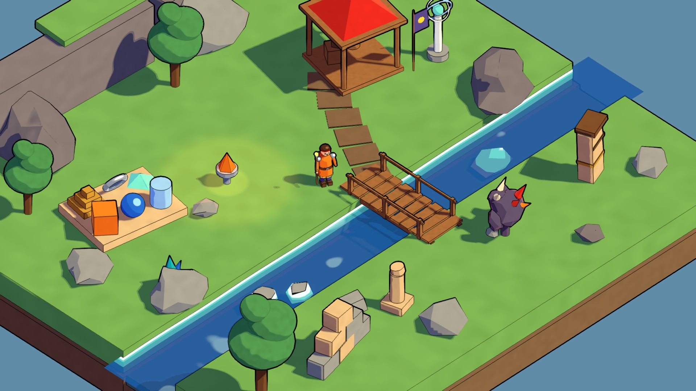
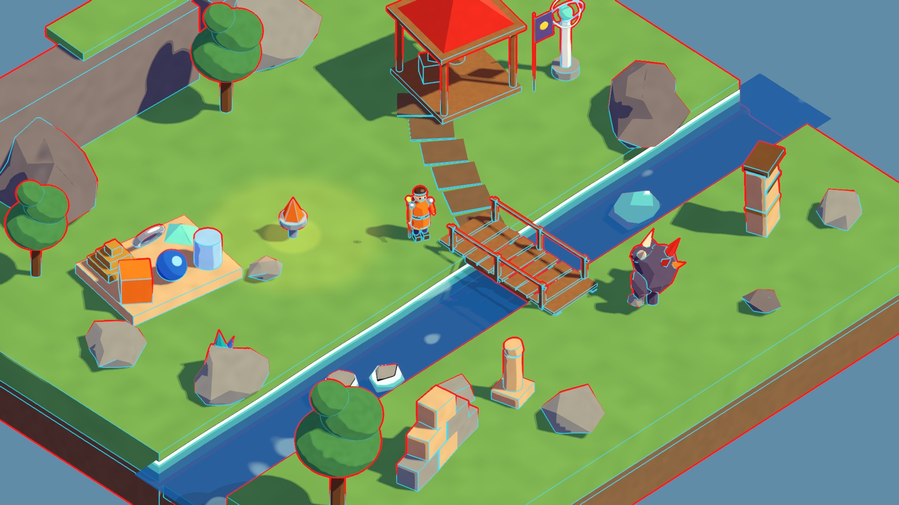
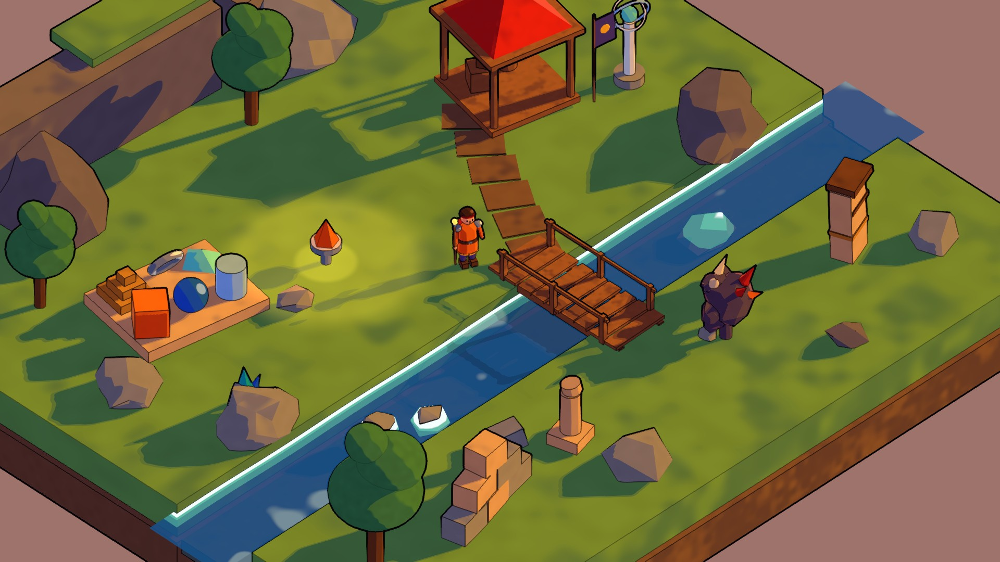
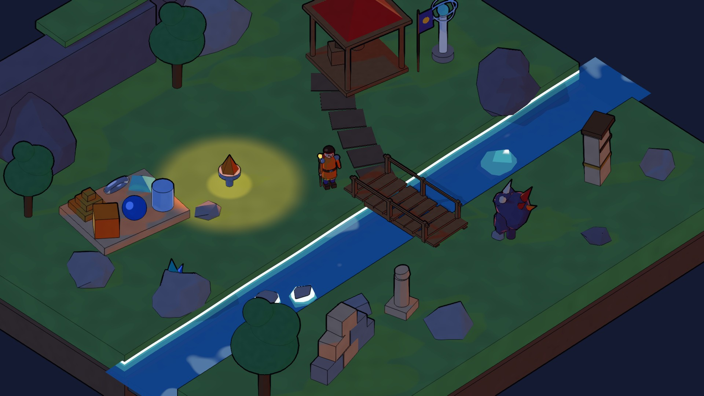

# P07a – Visual Style Guide (Comic-Fantasy)

**Stand:** 17.10.2026 · gilt für Spielfiguren (P01), Gegner (P04) und Spielwelt (P05). Referenzbilder: `docs/p07a_screenshots/`.

Avatar5 sieht aus wie ein handkolorierter Fantasy-Comic: klare schwarze Tuschekonturen, flache Farbflächen in zwei bis vier Helligkeitsstufen, farbige (nie schwarze) Schatten und kräftige, aber aufeinander abgestimmte Elementfarben. Der Stil ist eigenständig; keine Texturen, Figuren oder Designs anderer Spiele.

## 1. Linien (Tusche)

| Regel | Wert |
|---|---|
| Außenkontur (Silhouette) | 3 px bei 1080p, fast Schwarz (0.02, 0.02, 0.035), volle Deckkraft |
| Innenlinien | 1.5–1.6 px, 85–90 % Deckkraft, nur an echten Knicken (> ~49°) und Kontaktkanten |
| Ferne | Innenlinien blenden ab 36 m aus, Silhouetten bleiben |
| Figuren | volle Innenlinien (Gesicht, Gürtel, Schulterstücke, Waffe) |
| Vegetation | `Inner Line Weight` 0.25 (Laub) bzw. 0.7 (Gras), Silhouette bleibt |
| Kleine dunkle Details, Glüheffekte | `Exclude From Ink Lines` (z. B. Augen, Gegneraugen), sonst werden sie zu Tintenklecksen |
| Wasser, transparente Effekte | keine Tuschekonturen; Wasser hat eine dünne dunkle Uferlinie im Shader |

Prüfen mit Debug-Ansicht F4: „Line Types“ zeigt Silhouetten rot und Innenlinien cyan.

## 2. Cel-Shading

- **Stufen:** 3 als Standard; 2 für Effekte/Glühen, 4 für Metall. Übergang schmal (`Band Softness` 0.02, Stoff 0.04).
- **Schattenfarbe** wird mit der Grundfarbe multipliziert und verschiebt den Farbton Richtung Violett/Blau. Schatten sind nie schwarz oder grau-schlammig. Faustregel: Schattenfarbe mit Helligkeit 0.55–0.85 und leichtem Blau-/Violettstich.
- **Schlagschatten** springen in dieselbe Schattenstufe wie die Eigenschattierung (harte Comic-Schatten).
- **Glanzlichter** nur auf Metall, Wasser-Kristallen, Haaren: klein und hart. **Rim-Licht** sparsam für Figuren und magische Objekte.
- **Handgemalte Wirkung:** `Band Wobble` 0.06 (Standard) bis 0.14 (Laub), Farbvariation 0.04–0.08. Holz und Stein dürfen mehr Variation tragen als Haut und Stoff.

## 3. Farbpalette

Werte = `Base Colour` (sRGB). Schatten = Basis × `Shade Colour`.

| Familie | Material | Basis | Schattenfarbe | Einsatz |
|---|---|---|---|---|
| Feuer | Toon_Fire_Orange | (1.00, 0.50, 0.12) | (0.74, 0.42, 0.55) | Feuer-Klasse, Gewänder, Glut |
| | Toon_Fire_Red | (0.86, 0.16, 0.12) | (0.62, 0.42, 0.68) | Akzente, Dächer, Kristalle |
| | Toon_Fire_Yellow | (1.00, 0.82, 0.22) | (0.82, 0.56, 0.50) | Säume, Embleme |
| | Toon_Fire_Flame | (1.00, 0.78, 0.25) + Emission | – | Flammen |
| Wasser | Toon_Water_Blue | (0.13, 0.42, 0.86) | (0.55, 0.55, 0.82) | Wasser-Klasse, Kristalle |
| | Toon_Water_Turquoise | (0.10, 0.72, 0.72) | (0.50, 0.62, 0.82) | Akzente, Glanz |
| | Toon_Water_Surface | flach (0.35, 0.85, 0.85) → tief (0.08, 0.35, 0.65) | – | Flüsse, Seen |
| Erde | Toon_Earth_Ochre | (0.80, 0.58, 0.20) | (0.64, 0.50, 0.60) | Erd-Klasse, Bänder |
| | Toon_Earth_Brown | (0.46, 0.29, 0.16) | (0.62, 0.50, 0.64) | Stämme, Leder |
| | Toon_Earth_Sandstone | (0.87, 0.73, 0.53) | (0.68, 0.57, 0.68) | Ruinen, Plattformen |
| Luft | Toon_Air_LightBlue | (0.62, 0.82, 0.98) | (0.62, 0.66, 0.88) | Luft-Klasse, Ringe |
| | Toon_Air_White | (0.95, 0.95, 0.92) | (0.66, 0.70, 0.86) | Säulen, Wolken |
| | Toon_Air_Turquoise | (0.45, 0.90, 0.84) | (0.55, 0.68, 0.86) | Orbs, Akzente |
| Neutral | Toon_Neutral_Wood | (0.63, 0.41, 0.23) | (0.60, 0.48, 0.62) | Holzbauten |
| | Toon_Neutral_Stone | (0.62, 0.62, 0.60) | (0.56, 0.57, 0.74) | Felsen, Blöcke |
| | Toon_Neutral_Metal | (0.62, 0.66, 0.72), 4 Stufen, Specular, Rim | (0.45, 0.50, 0.68) | Rüstung, Beschläge |
| | Toon_Neutral_Cloth | (0.33, 0.27, 0.56) | (0.62, 0.52, 0.76) | Stoffe, Banner |

Weitere: Umgebung (Gras, Erde, Flussbett, Klippe, Laub), Charaktere (Haut, Haar, Augen, Leder), Gegner (Haut, Knochen, Glühen). Alle Definitionen stehen datengetrieben in `ToonMaterialLibrary.cs`.

**Lesbarkeit:** Spielfiguren tragen die gesättigtste Farbe ihres Elements; Umgebung ist gedämpfter (Gras, Stein, Holz), damit Figuren sich abheben. Rot/Gelb bleibt für Gefahr und Telegraphing reserviert (Designbibel P07); Gegner nutzen dunkles Violett mit roten Akzenten.

## 4. Licht

- Hauptlicht gerichtet, weiche Schatten an (werden im Shader hart quantisiert), Schattendistanz aus dem PC-Pipeline-Asset.
- Umgebungslicht als Trilight-Gradient (Himmel/Horizont/Boden), über `Ambient Influence` nur zu 50 % im Schatten wirksam, damit Schatten bei allen Tageszeiten farbig bleiben.
- Presets (F5): Day, Golden Hour, Overcast, Night. Alle vier sind in den Tests auf Lesbarkeit der Figur geprüft (mittlere Helligkeit 0.22–0.51, < 10 % fast-schwarze Pixel).
- Keine Tonemapping-, Vignetten- oder Motion-Blur-Effekte im Comic-Look (sie vergrauen Tusche und Flächen).

| Golden Hour | Night |
|---|---|
|  |  |

## 5. Formen und Modelle

- Moderat polygonarm, klare Silhouetten, leicht übertriebene Proportionen (großer Kopf, breite Schultern, große Hände/Waffen).
- Facettierte (flach schattierte) Felsen und Kristalle, glatte Normalen für Figuren.
- Details, die eine Innenlinie bekommen sollen, als echte Geometriekante modellieren (Gürtel, Säume, Schulterstücke) statt in Texturen malen.
- Maßstab 1 Unit = 1 m; Figurenhöhe ca. 2 m bei Gameplay-Kamera (Pitch 40°, Yaw 45°, Ortho-Größe 8).

## 6. Neues Material anlegen

1. Ein passendes Material aus `Assets/_Game/Rendering/Materials` duplizieren **oder** in `ToonMaterialLibrary.Definitions` einen Eintrag ergänzen und den Generator laufen lassen (`Avatar5/Setup/Build P07a Visual Style Test`).
2. Shader immer `Avatar5/Toon` (Wasser: `Avatar5/Toon Water`). Keine URP-Lit/PBR-Materialien im Spiel.
3. Schattenfarbe mit Blau-/Violettstich wählen, nicht einfach dunkler.
4. Für Vegetation und kleinteilige Flächen `Inner Line Weight` senken; winzige dunkle Details ausschließen.
5. Szene braucht ein Volume mit `Avatar5/Ink Outline` → `Enable Ink`.

## 7. Nicht machen

- Dicke (> 4 px) Linien oder schwarze Flächen statt Schattierung.
- Fotorealistische PBR-Materialien, Fototexturen, Normal Maps mit Mikrodetail (erzeugen Linienrauschen).
- Fremde oder ungeprüft lizenzierte Assets; geschützte Avatar-/Borderlands-Inhalte.
